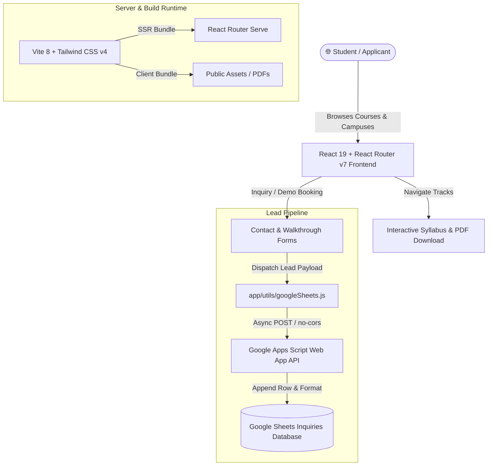

<div align="center">

  

  # ⚡ TekZen Technologies
  ### *Simplifying Tech Excellence • Your Success, Our Mission*

  [](https://react.dev/)
  [](https://reactrouter.com/)
  [](https://tailwindcss.com/)
  [](https://vitejs.dev/)
  [](https://bun.sh/)
  [](https://www.tekzentechnologies.com)

  <p align="center">
    <strong>The official web application and curriculum portal for TekZen Technologies</strong><br />
    An elite IT training and software apprenticeship institute empowering aspiring engineers, graduates, and professionals with industry-grade engineering skills.
  </p>

  <p align="center">
    <a href="#-about-tekzen">About</a> •
    <a href="#-featured-curriculum">Curriculum</a> •
    <a href="#-key-features">Features</a> •
    <a href="#-system-architecture">Architecture</a> •
    <a href="#-tech-stack">Tech Stack</a> •
    <a href="#-quick-start">Quick Start</a> •
    <a href="#-environment-configuration">Environment</a> •
    <a href="#-campus--contact">Contact</a>
  </p>

</div>

---

## 🌟 About TekZen

**TekZen Technologies** is an industry-focused IT training institute situated in **Indore, Madhya Pradesh**. We bridge the gap between academic theory and practical industry requirements through:

- **Hands-on Apprenticeship**: Building production-ready software rather than memorizing syntaxes.
- **Project-Centric Pedagogy**: Real-world assignments mimicking actual software development cycles.
- **Dedicated Mentorship**: 1-on-1 guidance by seasoned technology practitioners.
- **The 4-Stage Learning Path**: `Learn` (Fundamentals) ➔ `Practice` (Problem Solving) ➔ `Build` (Portfolio Capstones) ➔ `Grow` (Interview Mastery & Career Launch).

---

## 🎓 Featured Curriculum

Each course track features an in-depth curriculum breakdown on the platform, complete with downloadable official PDF syllabi:

| Track | Focus Areas | Key Technologies | Syllabus |
| :--- | :--- | :--- | :---: |
| **C Programming** | Memory model, pointers, data structures, algorithms | C11, GCC, Valgrind, Memory Management | [📥 Download PDF](./public/Courses/C%20Programming.pdf) |
| **C++ Programming** | Object-oriented design, STL, modern C++ patterns | Modern C++ (C++17/20), OOP, STL, CMake | [📥 Download PDF](./public/Courses/CPP%20Programming.pdf) |
| **Java Core** | OOP principles, Collections, Concurrency, JVM internals | Java 17/21, Collections Framework, Multithreading | [📥 Download PDF](./public/Courses/JAVA%20CORE.pdf) |
| **Data Analytics** | Business intelligence, data cleansing, reporting | Python, SQL, Advanced Excel, Power BI | [📥 Download PDF](./public/Courses/Data%20Analytics.pdf) |
| **Data Science** | Machine learning, predictive modeling, deep learning | Python, Pandas, Scikit-Learn, TensorFlow, NLP | [📥 Download PDF](./public/Courses/Data%20Science.pdf) |

---

## ✨ Key Platform Features

- ⚡ **React Router v7 Full-Stack Engine**: Blazing fast Server-Side Rendering (SSR) and client-side hydration powered by Vite 8.
- 🎨 **Modern Cyber-Emerald Aesthetic**: Sleek glassmorphism, responsive micro-interactions, and curated dark/light palettes styled with Tailwind CSS v4.
- 📑 **Dynamic Syllabus Explorer**: Filterable tabs for every course track with module-by-module topics, prerequisites, career pathways, and instant PDF downloads.
- 📬 **Serverless Inquiries via Google Sheets API**: High-efficiency lead capture and demo seat reservation system connected via a Google Apps Script Web App without heavy backend overhead.
- 🏢 **Campus Walkthrough Booking**: Modal-driven scheduling system for on-site lab visits and demo lecture reservations.
- 🗺️ **Indore Campus Locator**: Direct counselor contact lines, interactive FAQs, and verified campus address near Aurobindo Hospital.

---

## 🏗️ System Architecture



---

## 💻 Tech Stack

### Core Framework & Runtime
- **Frontend Framework**: [React 19](https://react.dev/)
- **Routing & SSR**: [React Router v7](https://reactrouter.com/) (Framework Mode)
- **Runtime & Package Manager**: [Bun](https://bun.sh/) / [Node.js](https://nodejs.org/) (v20+)
- **Build Tool**: [Vite 8](https://vitejs.dev/)

### Styling & UI
- **CSS Framework**: [Tailwind CSS v4](https://tailwindcss.com/) via `@tailwindcss/vite`
- **Iconography**: [@heroicons/react](https://github.com/tailwindlabs/heroicons)
- **Typography**: Inter / Outfit modern sans typography

### Automation & Integrations
- **Lead Capture**: Google Apps Script Web App endpoint (`VITE_GOOGLE_SHEETS_SCRIPT_URL`)
- **Document Distribution**: Bundled high-resolution PDF course roadmaps (`/public/Courses/`)

---

## 📁 Project Structure

```text
TekZen/
├── app/
│   ├── Components/           # Reusable UI widgets (Navbar, Footer, Modals, Buttons)
│   ├── Layout/
│   │   └── Layout.jsx        # Global master layout shell with sticky navigation
│   ├── routes/
│   │   ├── About/            # About page: Mission, 6 Pillars, 4-Stage Path, Campus specs
│   │   ├── ContactUs/        # Contact Atelier: Inquiry form, FAQs, Walkthrough modal
│   │   ├── Courses/          # Course catalog, detailed syllabus viewer, & data models
│   │   ├── Home/             # Landing page, hero showcase, course highlights
│   │   └── Testimonial/      # Student success stories & alumni feedback
│   ├── utils/
│   │   └── googleSheets.js   # Serverless dispatch utility for Google Sheets Webhook
│   ├── app.css               # Global Tailwind CSS directives & root styles
│   ├── root.jsx              # Document shell, SEO meta tags, font imports
│   └── routes.js             # Declarative React Router route definitions
├── public/
│   ├── Courses/              # Downloadable course syllabus PDFs (C, C++, Java, DS, DA)
│   ├── Tekzen logo - dark.png
│   ├── tekzen-logo-white.png
│   ├── favicon.ico
│   └── indore_map.png        # Campus location map visual
├── .env.example              # Template environment variables
├── package.json              # Project dependencies & scripts
├── tailwind.config.js        # Custom Tailwind design tokens & themes
└── vite.config.js            # Vite bundler & React Router dev plugins
```

---

## 🚀 Quick Start

### 1. Prerequisites
Ensure you have either **Bun** (recommended) or **Node.js 20+** installed on your system.

```bash
# Verify Node / Bun version
node -v   # >= v20.0.0
# or
bun -v    # >= v1.0.0
```

### 2. Clone the Repository
```bash
git clone https://github.com/TekZen-Tech/TekZen.git
cd TekZen
```

### 3. Install Dependencies
```bash
# Using Bun (Recommended)
bun install

# Or using npm
npm install
```

### 4. Configure Environment Variables
Create a local `.env` file based on `.env.example`:

```bash
cp .env.example .env
```

Add your Google Apps Script Web App URL:
```env
VITE_GOOGLE_SHEETS_SCRIPT_URL="https://script.google.com/macros/s/YOUR_DEPLOYMENT_ID/exec"
```

### 5. Launch the Development Server
```bash
# Using Bun
bun run dev

# Or using npm
npm run dev
```

Visit [`http://localhost:5173`](http://localhost:5173) in your browser.

---

## 🛠️ Build & Production Deployment

### Compile Production Bundle
```bash
bun run build
# or: npm run build
```

This compiles client-side assets and the server bundle into `./build/`.

### Run Production Server
```bash
bun run start
# or: npm run start
```

The production server will listen on `http://localhost:3000`.

---

## 📋 Available Scripts

| Script | Command | Purpose |
| :--- | :--- | :--- |
| `dev` | `react-router dev` | Starts Vite HMR dev server at `localhost:5173` |
| `build` | `react-router build` | Builds optimized SSR server and client assets |
| `start` | `react-router-serve ./build/server/index.js` | Runs production server on port 3000 |
| `typecheck` | `react-router typegen && tsc` | Verifies TypeScript types & route type generation |

---

## ⚙️ Google Sheets Integration Setup

The inquiry and trial pass forms send payload data to a Google Spreadsheet via a Google Apps Script Web App:

1. Create a Google Spreadsheet with column headers:
   `Full Name`, `Email`, `Phone Number`, `Course Interested`, `Who Are You?`, `Learning Mode`, `Question / Message`, `Timestamp`.
2. Open **Extensions** ➔ **Apps Script** and deploy a `doPost(e)` script handling JSON or form data.
3. Deploy as a **Web App** with access set to:
   - **Execute as**: *Me*
   - **Who has access**: *Anyone*
4. Copy the deployment URL into `.env` as `VITE_GOOGLE_SHEETS_SCRIPT_URL`.

---

## 📍 Campus & Contact Atelier

Feel free to visit our campus or connect with our academic counselors:

<div align="center">

| Campus Detail | Information |
| :--- | :--- |
| **📍 Address** | 1st Floor, Kalyani Market, near London Villas, in front of Shankheshwar City, near Sri Aurobindo Hospital, Indore, Madhya Pradesh |
| **📞 Contact Numbers** | [+91 96858 25273](tel:+919685825273) / [+91 97544 75280](tel:+919754475280) |
| **✉️ Official Email** | [info@tekzentechnologies.com](mailto:info@tekzentechnologies.com) |
| **🌐 Website** | [www.tekzentechnologies.com](https://www.tekzentechnologies.com) |
| **⏰ Operating Hours** | Monday – Saturday: 9:00 AM – 7:00 PM IST |

</div>

---

<div align="center">
  <sub>Designed & Developed with ❤️ by the <strong>TekZen Technologies</strong> Engineering Team.</sub>
</div>
